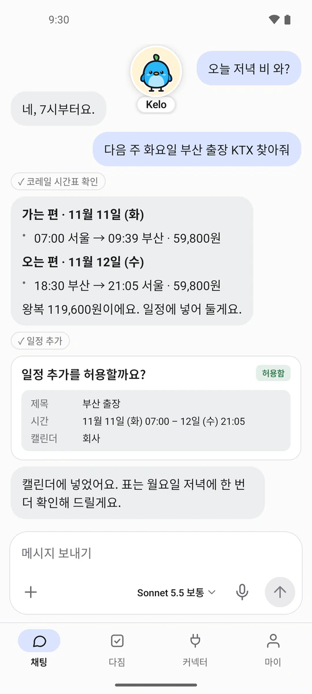
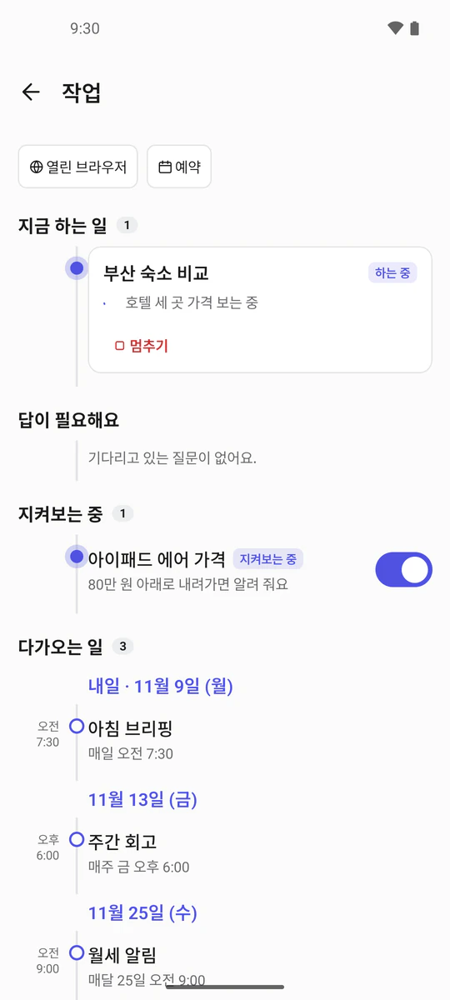
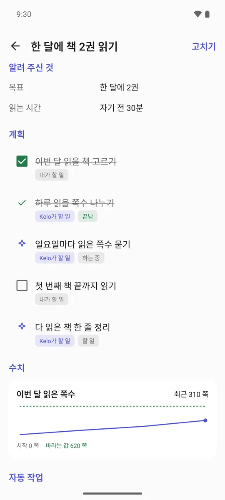
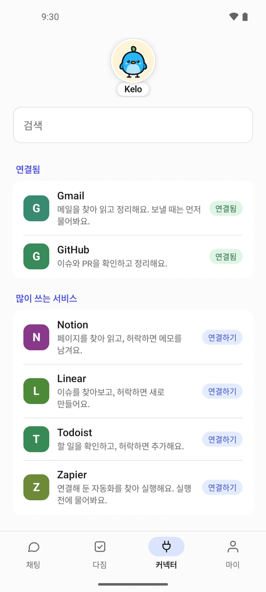

<p align="center"></p>

<p align="center">
  <b>원하는 곳에 둔 서버에서, 원하는 AI 모델로 돌아가는 나만의 AI 비서예요. 로컬 모델도 돼요.</b><br>
  휴대폰으로 말을 걸면 비서가 자기 브라우저와 연결한 서비스로 일을 처리하고, 되돌리기 어려운 일은 꼭 먼저 물어봐요.
</p>

<p align="center">
  <a href="https://kelo.chat"></a>
  <a href="https://kelo.chat/#install"></a>
  <a href="https://www.gnu.org/licenses/agpl-3.0.html"></a>
  <a href="https://kelo.chat/#get-app"></a>
  <a href="README.md"></a>
</p>

<p align="center">
  <a href="https://kelo.chat/?lang=ko">kelo.chat</a> ·
  <a href="docs/install.md">설치</a> ·
  <a href="CHANGELOG.md">변경 기록</a> ·
  <a href="README.md">English</a>
</p>

---

## Kelo가 다른 점

**서버는 원하는 곳에.** Kelo 서버는 집에 있는 Mac, Linux 서버, Docker가 되는 미니 PC나 NAS, 클라우드 서버 어디에나 둘 수 있어요.
대화, 기억, 파일, 키는 그 서버에 남고, 휴대폰 앱은 리모컨이에요.

**모델은 원하는 걸로, 로컬 모델까지.** Claude, GPT, Gemini, DeepSeek, Qwen, Mistral, Grok, OpenRouter 등 약 30곳에서 고르거나,
LM Studio, Ollama 같은 OpenAI 호환 서버로 내 장비에서 직접 돌릴 수 있어요. 로컬 모델을 쓰면 대화가 밖으로 나가지 않아요.
기본 모델이 실패하면 다른 회사의 대체 모델이 이어받아요.

**먼저 물어봐요.** 찾아보는 일은 알아서 해요. 결제, 주문, 예약, 보내기, 삭제, 계정 변경처럼 무언가를 확정하는 일은 휴대폰으로
허락을 받은 다음에 해요. 사이트가 사람인지 확인하려고 하면, 우회하지 않고 브라우저를 사용자에게 넘겨줘요.

<p align="center">
  
  
</p>

## 할 수 있는 일

- **휴대폰으로 대화** — 글이나 말로, 사진과 문서(PDF, Word, Excel)도 함께. 다른 앱에서 "Kelo에게 보내기"로 넘길 수도 있어요.
- **자기 브라우저** — 사이트를 열어 읽고 비교하고, 양식을 채우고, 저장해 둔 로그인으로 들어가요. 실시간으로 보다가 직접 조작하고
  다시 맡길 수 있어요.
- **브라우저 없이 빠른 검색** — 가격, 비교, 사실 확인은 채팅 안에서 바로 웹 검색으로 답해요.
- **백그라운드 작업** — 오래 걸리는 일은 단계별로 보여 주며 이어서 하고, 필요한 질문은 채팅에 카드로 와요.
- **예약과 감시** — 정한 때에 일을 하고, 페이지에 특정 글자가 보이거나 숫자가 기준을 넘으면 알려 줘요.
- **다짐** — 목표를 적어 두면 계획, 단계, 숫자, 기한을 함께 챙겨요.
- **커넥터** — Gmail과 다른 메일함, 캘린더, GitHub, Notion, Linear, Todoist 등. 연결은 각 서비스의 로그인 화면에서 해요.
- **키체인과 카드** — 비밀번호와 키는 채팅이 아니라 입력 칸으로 넣고, 비서는 값을 볼 수 없어요. 카드는 내 휴대폰만 가진 키로
  잠글 수 있어요.
- **알림** — 일이 끝나거나 허락이 필요할 때. 푸시에는 내용이 담기지 않고, 앱이 내 서버에서 직접 가져와요.
- 앱은 **20개 언어**를 지원하고, Kelo는 사용자가 쓴 언어로 답해요.

<p align="center"></p>

## 앱

<p>
  <a href="https://apps.microsoft.com/detail/9P54HX2TX361?hl=ko-kr&gl=KR"></a>
  <a href="https://apps.apple.com/kr/app/kelo-ai/id6832422201"></a>
  <a href="https://kelo.chat/tester"></a>
</p>

| 플랫폼 | 상태 |
|---|---|
| Android | 네이티브 앱 (Kotlin + Jetpack Compose). 베타 테스트 중: [kelo.chat/tester](https://kelo.chat/tester)에서 신청하거나 APK를 직접 설치하세요: [kelo.chat/download/android](https://kelo.chat/download/android). Google Play는 베타 뒤에 올라와요 |
| Windows / macOS 데스크톱 | 네이티브 앱 (Compose Multiplatform): 채팅, 허락, 실시간 브라우저, 트레이, 알림. Windows: [Microsoft Store](https://apps.microsoft.com/detail/9P54HX2TX361?hl=ko-kr&gl=KR) 또는 설치 파일 직접 받기: [설치 파일 (.exe)](https://kelo.chat/download/windows) 또는 [MSI](https://kelo.chat/download/windows-msi), macOS (Apple 실리콘): [디스크 이미지 (.dmg)](https://kelo.chat/download/mac) |
| iOS | 네이티브 앱 (SwiftUI), [App Store](https://apps.apple.com/kr/app/kelo-ai/id6832422201)에서 받을 수 있어요 (iOS 17 이상) |

지금 빌드의 버전, 크기, SHA-256: [kelo.chat/download/latest.json](https://kelo.chat/download/latest.json)

- **Android:** APK를 여세요. Android가 물으면 이 출처(브라우저나 파일 앱)의 앱 설치를 허용하세요. Android 8.0 이상.
- **Windows:** Microsoft Store에서 받으면 이 경고는 없어요. 직접 받는 설치 파일에는 아직 코드 서명이 없어서 SmartScreen이 막을 수 있어요. **추가 정보 → 실행**을 누르세요. Windows 10, 11.
- **macOS:** Kelo를 응용 프로그램 폴더로 끌어 놓으세요. Apple 공증을 받은 앱이라 바로 열려요. Apple 실리콘(M1 이상) Mac용.

<p align="center">
  
  
  
  
</p>

### 내려받은 파일 확인하기

파일을 믿을 필요 없이, 공개된 소스 코드만 믿으면 돼요. 릴리스마다 GitHub Actions가 공개적으로 빌드하고
([`release-build.yml`](.github/workflows/release-build.yml)), 모든 파일에는 어느 소스로 만들었는지 적힌 서명된 기록이 붙어요.

```sh
gh attestation verify Kelo-<버전>.msi -R kelo-chat/kelo     # .exe, .msix, Android 파일도 같아요
```

- **Android (kelo.chat에서 받은 APK):** 고정된 Docker 환경에서 빌드하므로, 태그가 붙은 소스를 직접 빌드하면 같은 파일이 나와요.
  `tools/verify/android-verify.sh --tag <태그>`가 빌드해서 폰에 설치된 APK와 비교해요. (서명만 비교에서 빠져요.)
  **Google Play** 버전은 Google Play가 배포하는 앱에 자체 보호 코드를 넣어서 바이트 단위 비교가 안 돼요. 확인하려면 kelo.chat에서 받은 APK를 설치하세요.
- **Windows:** 설치 파일은 바이트 단위로 똑같이 다시 만들 수는 없어요. 대신 어느 워크플로와 커밋이 만들었는지 증명이 붙어요.
- **iPhone:** Apple이 App Store 앱을 기기마다 암호화해서 바이트 단위 비교는 불가능해요. 대신 확인할 수 있는 것을 문서에 적었어요.

방법, 한계, 확인되지 않는 부분: [docs/ko/verify-builds.md](docs/ko/verify-builds.md)

## 서버 설치

**필요한 것:** Docker (macOS/Windows는 Docker Desktop, Linux는 Docker Engine)

| | RAM | CPU | 남은 디스크 |
|---|---|---|---|
| 최소 | 2 GB | 2코어 | 10 GB |
| 권장 | 4 GB | 4코어 | 20 GB |

설치할 때 이 중 하나(또는 제한 없음)를 고르면, Kelo는 그 안에서만 동작해요. 모든 컨테이너를 합친 양이고 프로그램 파일도
포함이에요. 나중에 `kelo limits --choose`로 바꿀 수 있어요.

한 줄 설치는 Kelo가 공개되는 날 열려요.

```bash
# macOS, Linux
curl -fsSL https://kelo.chat/install.sh | bash
```

```powershell
# Windows (PowerShell, WSL 2를 쓰는 Docker Desktop)
irm https://kelo.chat/install.ps1 | iex
```

그 전에는 이 저장소를 받아서 실행해요.

```bash
KELO_SOURCE=/path/to/this/repo bash scripts/install.sh
```

설치 프로그램이 Docker를 확인하고 Kelo를 복사한 다음, 4단계 안내 화면을 열어요: 서버 확인 → 크기 고르기 → Kelo 시작 → QR 코드로
휴대폰 연결. AI 모델은 그다음에 앱에서 골라요. 자세한 안내: [docs/install.md](docs/install.md)

### 휴대폰에서 서버에 닿는 방법

- **Kelo 주소 (현재 한정 제공)** — 현재 한정 제공 중인 `kelo.chat` 하위 주소 (`kelo connect kelo --name <이름>`). 제공 범위와 조건은 바뀔 수 있어요.
- **Tailscale** — 공개 주소 없이 나만 접속
- **내 도메인** — DuckDNS나 갖고 있는 도메인

#### Nginx Proxy Manager로 연결하기

이미 Nginx Proxy Manager(NPM)를 쓰고 가진 도메인이 있다면 5분 정도면 돼요 (`kelo.example.com`은 내 이름으로):

1. DNS에서 `kelo.example.com`이 NPM이 받는 주소를 가리키게 해요.
2. Kelo가 설치된 컴퓨터에서 `assistant connect domain --host kelo.example.com --proxy`를 실행해요. 넘겨 줄 주소를 `http://192.168.1.20:8080`처럼 출력해 줘요.
3. NPM에서 **Hosts → Proxy Hosts → Add Proxy Host**. Details 탭: Domain Names `kelo.example.com`, Scheme `http`, Forward Hostname / IP는 출력된 주소(`http://` 제외), Forward Port는 출력된 포트(기본 8080). **Websockets Support**와 **Block Common Exploits**를 켜요.
4. SSL 탭: *Request a new SSL Certificate*, **Force SSL**, **HTTP/2 Support**를 켜고 Let's Encrypt 약관에 동의해요.
5. Advanced 탭에 아래 두 줄을 넣고 Save (답이 바로바로 보이고 사진도 올릴 수 있게 해 줘요):

   ```
   proxy_buffering off; proxy_request_buffering off; proxy_cache off;
   proxy_read_timeout 300s; proxy_send_timeout 300s; client_max_body_size 30m;
   ```
6. `assistant connect status`로 확인하고 `assistant phone add`로 나온 QR 코드를 Kelo 앱으로 스캔해요. 앱은 이제 `https://kelo.example.com`을 써요.

Kelo는 집 네트워크 안에서 평문 http로 답하니, 방화벽이 허용하면 NPM만 그 포트에 닿게 해 주세요. 되돌리려면 `assistant connect off`를 실행하고 NPM에서 호스트를 지워요.

[docs/connect.md](docs/connect.md)를 보세요.

### 팁: Kelo를 무료로 운영하기

서버와 모델에 돈을 쓰지 않고도 Kelo를 돌릴 수 있어요. Oracle Cloud의 Always Free에는 계속 무료인 Arm 서버가 들어 있고,
[FreeLLMAPI](https://github.com/tashfeenahmed/freellmapi)는 여러 모델 회사의 무료 사용량을 OpenAI 호환 주소 하나로 묶어 줘요.
Kelo 이미지는 x86뿐 아니라 Arm(linux/arm64)으로도 빌드돼요. Chromium도 포함이에요.

1. **서버 만들기.** [Oracle Cloud Free Tier](https://www.oracle.com/cloud/free/)에 가입하고 **홈 리전**(Always Free는 홈 리전에서만
   돼요)에 VM을 만들어요. Shape는 **VM.Standard.A1.Flex**(Ampere, Arm), **2 OCPU · 메모리 12 GB**, 이미지는 **Ubuntu**(aarch64).
   Always Free A1 한도 전부예요. 기본 부트 볼륨이면 충분해요(블록 스토리지는 합쳐서 200 GB까지 무료). "Out of host capacity"가
   나오면 지금 남은 무료 Arm 서버가 없다는 뜻이니, 다른 가용성 도메인을 고르거나 나중에 다시 해 보세요.
2. **Kelo 설치.** SSH로 접속해 위의 설치 프로그램을 실행해요. Docker 설치도 제안하고, 이어서 안내 화면이 열려요. 이 VM은 Kelo
   전용이니 크기는 **제한 없음**이 알맞아요. 현재 한정 제공 중인 `https://<이름>.kelo.chat` 주소를 고르세요. 바깥으로 나가는 터널로 연결돼서
   Oracle 방화벽에 포트를 열 필요가 없어요.
3. **같은 VM에 FreeLLMAPI 추가.** Kelo의 Docker 네트워크에 붙여서, 인터넷에는 닫아 둔 채 Kelo가 이름으로 찾아가게 해요.

   ```bash
   curl -fsSL https://freellmapi.co/install.sh | bash
   cd ~/freellmapi
   cat > docker-compose.override.yml <<'EOF'
   services:
     freellmapi:
       networks: [default, kelo]
   networks:
     kelo:
       name: kelo_agent   # Kelo가 ~/kelo에 있을 때의 네트워크 이름 (`docker network ls`로 확인)
       external: true
   EOF
   docker compose up -d
   ```

   대시보드는 노트북에서 SSH로 열어요(`ssh -L 3001:127.0.0.1:3001 ubuntu@<서버 주소>` 후 `http://localhost:3001`). 가입해 둔
   무료 API 키를 넣고, 통합 키(unified key)를 복사해요.
4. **Kelo에 연결.** 앱의 마이 → 모델 → **Custom endpoint**에서 서버 주소 `http://freellmapi:3001/v1`, API 키는 통합 키, 모델은
   `auto`로 정해요(FreeLLMAPI가 무료 모델을 고르고, 한 곳이 한도에 걸리면 다음 곳으로 넘겨요).

알아 둘 점:

- **무료 모델은 도구 사용이 약해요.** 무료 모델은 보통 유료 모델보다 느리고, 도구 사용(브라우저 조작, 양식 입력, 여러 단계 작업)이
  덜 안정적이에요. 하루 한도가 바닥날 수도 있어요. 중요한 일에는 유료 모델을 기본이나 대체 모델로 두는 편이 안전해요.
- **각 서비스의 약관이 적용돼요.** FreeLLMAPI는 한 사람이 직접 쓰도록 만든 별도의 MIT 라이선스 프로젝트예요. Oracle 약관과 모델
  회사마다의 무료 사용 약관(한도, 데이터 사용, 허용 용도)도 그대로 적용돼요.

### 자주 쓰는 명령

```bash
kelo status            # 서버별 실행 여부와 주소
kelo phone add         # 다른 휴대폰 연결 (QR 코드)
kelo limits --choose   # 권장, 최소, 제한 없음 중에서 고르기
kelo instance create alex   # 같은 서버에서 다른 사람용 Kelo (데이터와 키 따로)
kelo instance list           # 모든 Kelo와 주소, 실행 여부
kelo instance stop alex      # 멈추기 (데이터는 남고, `kelo instance start alex`로 다시 켜요)
kelo instance delete alex    # 완전히 삭제 (대화, 키, 파일, 설정, 주소까지)
```

### 구독 계정으로 로그인 (선택)

`kelo enable oauth`를 실행하면 API 키 대신 Claude, Antigravity 등의 구독 계정으로 로그인할 수 있어요. 이때 Claude Code와
Antigravity가 각각 별도 컨테이너로 설치되고, 로그인은 앱의 마이 → 모델에서 해요. 이 회사들이 다른 앱에서 구독을 써도 된다고
공식적으로 허락한 것은 아니라서, 앱이 처음 쓰기 전에 한 번 물어봐요. 끄기: `kelo disable oauth`

### Kelo가 쓸 안드로이드 기기 (선택)

웹사이트가 없거나 불편한 앱(배달, 예약, 앱 전용 쿠폰)은 Kelo가 안드로이드 기기를 직접 조작해요. 화면을 읽고, 누르고, 한글도
입력하고, 앱을 열어요. 결제·보내기·삭제는 브라우저와 똑같이 먼저 물어보고, 로그인은 보안 카드에 넣은 정보로 Kelo가 직접 입력해요.
기기는 이 중 하나면 돼요.

- **Kelo 옆**: 집 안 리눅스 기기에서 돌리는 [redroid](https://github.com/remote-android/redroid-doc)(컨테이너 안드로이드), 에뮬레이터, 가상 머신
- **남는 폰**: 무선 디버깅을 켠 휴대폰
- **Kelo와 같은 리눅스 서버** (Mac·Windows의 Docker Desktop에서는 redroid가 돌지 않아요)

`.env`에 설정을 넣고, 연결 컨테이너(기기와 adb로 이야기하는 작은 컨테이너)를 만든 다음 업데이트해요.

```bash
COMPOSE_PROFILES=...,android               # 지금 쓰는 프로필에 android 추가
ANDROID_DEVICE=192.168.0.20:5555           # 기기의 adb 주소
ANDROID_BRIDGE_TOKEN=<32자 이상 아무 문자열>
```

```bash
docker compose --profile android build android
kelo update
```

어디에 두느냐에 따라 필요한 것:

| | Kelo 옆 (리눅스의 redroid) | Kelo와 같은 서버 (redroid) | 남는 폰 |
| --- | --- | --- | --- |
| 기계 | Docker가 있는 x86_64 또는 arm64 리눅스, 여유 메모리 2.5GB, 디스크 4GB | Kelo 서버 자체(리눅스만), 메모리 2.5GB 추가 | 항상 켜 두고 충전 중인 Android 11 이상 폰 |
| 커널 | `binder_linux`(대부분의 배포판, Ubuntu는 `linux-modules-extra`), Android 15는 `loop`, `erofs`도 | 같음 | 필요 없음 |
| 설정 | 아래 명령 실행 후 `ANDROID_DEVICE=<그 기기의 집 안 주소>:5555` | 아래 명령에서 `-p` 대신 `--network <kelo 프로젝트>_android-out`으로 띄우고(`docker network ls`로 이름 확인, 포트를 열지 않아요) `ANDROID_DEVICE=redroid:5555` | 개발자 옵션 → 무선 디버깅 → 페어링 코드로 기기 페어링, 컴퓨터에서 `adb pair` / `adb connect` 한 번, `ANDROID_DEVICE=<폰 주소>:<포트>` |
| 네트워크 | Kelo 서버가 기기 포트에 닿아야 해요(Mac의 Docker Desktop·colima는 로컬 네트워크 권한이나 작은 중계 프로그램이 필요할 수 있어요) | 없음 | 폰과 서버가 같은 네트워크 |

리눅스에서 redroid 띄우기 (Android 15):

```bash
echo "options binder_linux devices=binder,hwbinder,vndbinder" | sudo tee /etc/modprobe.d/redroid.conf
printf "binder_linux\nloop\nerofs\n" | sudo tee /etc/modules-load.d/redroid.conf
sudo modprobe binder_linux devices=binder,hwbinder,vndbinder && sudo modprobe loop && sudo modprobe erofs
printf 'KERNEL=="binder", MODE="0666"\nKERNEL=="hwbinder", MODE="0666"\nKERNEL=="vndbinder", MODE="0666"\n' | sudo tee /etc/udev/rules.d/60-redroid-binder.rules
sudo chmod 666 /dev/binder /dev/hwbinder /dev/vndbinder
docker run -d --privileged --name redroid --restart unless-stopped --memory 2560m -v redroid-data:/data \
  -p <집 안 주소>:5555:5555 redroid/redroid:15.0.0-latest \
  androidboot.redroid_gpu_mode=guest androidboot.redroid_width=720 androidboot.redroid_height=1280 androidboot.redroid_dpi=320
```

**Google Play 넣기.** redroid 기본 이미지에는 Google 앱이 없어요. x86_64에서는 LiteGapps로 직접 만들어요(MindTheGapps의 x86_64
빌드에는 2022년 Play 스토어가 들어 있어서 Android 14·15에서 죽어요). [regulad/redroid-script](https://github.com/regulad/redroid-script)의
빌드 방법은 받는 파일마다 체크섬이 고정돼 있어요. 완성된 이미지를 받지 말고 직접 빌드하세요.

```bash
git clone https://github.com/regulad/redroid-script && cd redroid-script
docker build -t redroid:15-gapps \
  --build-arg BASE=docker.io/redroid/redroid:15.0.0-250627 \
  --build-arg TOOLS=docker.io/library/alpine:3.24.3 --build-arg BUSYBOX=docker.io/library/busybox:1.38.0-musl \
  --build-arg GAPPS_KIND=litegapps --build-arg LITEGAPPS_TREE=x86_64/35 \
  --build-arg GAPPS_URL=<matrix.json의 litegapps-15.0-x86_64 url> --build-arg GAPPS_SHA256=<그 sha256> \
  --build-arg ADDON_URL=<litegapps-setupwizard-15.0-x86_64 url> --build-arg ADDON_SHA256=<그 sha256> \
  --build-arg NATIVE_BRIDGE=none .
```

그다음 위 `docker run`에서 `redroid/redroid:15.0.0-latest` 대신 `redroid:15-gapps`로 띄우고(데이터 볼륨은 새로), Kelo에게
"플레이스토어 로그인해 줘"라고 하면 로그인 카드로 넣은 정보를 기기에 입력해요. `NATIVE_BRIDGE=none`은 ARM 변환을 빼서, ARM 전용
앱은 설치되지 않아요. ARM 전용 앱이 꼭 필요하면 ARM 변환 계층을 넣지 말고, 예비 실물 폰이나 ARM 서버(라즈베리파이, Ampere 등)에서 redroid를
쓰세요. 변환 계층은 재배포 권리가 없는 비공개 파일이고 Android 15에서 불안정해요.

**한글 입력.** 기기에 [ADB Keyboard](https://github.com/senzhk/ADBKeyBoard)를 깔아야 해요(APK를 `adb install`한 뒤
`adb shell ime enable com.android.adbkeyboard/.AdbIME`).

은행·결제 앱은 보통 에뮬레이터에서 실행을 막고, 계정당 폰 한 대만 허용하는 앱은 실제 폰이 로그아웃될 수 있어요. 자세한 내용:
[docs/android-device.md](docs/android-device.md)

## 구조

- **서버** — Docker 안의 Python(FastAPI). 격리된 Chromium 브라우저, 내부 주소로는 나가지 못하게 막는 프록시, 코드 실행용 작업실이
  따로 있어요. 서버마다 SQLite 데이터베이스 하나이고, 비밀값은 암호화해 저장해요.
- **앱** — 모든 플랫폼에서 네이티브: Kotlin + Compose(Android, 데스크톱), SwiftUI(iOS). 웹뷰를 쓰지 않아요.
- **모델** — Anthropic, OpenAI, Google, OpenRouter, Bedrock, Vertex, Azure, DeepSeek, Mistral, xAI, Groq, Together, LM Studio,
  OpenAI 호환 서버 등.

더 보기: [docs/browser.md](docs/browser.md) (브라우저와 안전 규칙), [docs/push.md](docs/push.md) (알림), [docs/google.md](docs/google.md) (Google 로그인)

## 개인정보

**당신의 정보는 당신의 서버에만 있어요.** 대화, 메모, 저장한 키와 카드는 모두 당신이 운영하는 Kelo 서버에 저장돼요.
개발자에게는 그 서버에 들어갈 방법이 없고, 당신의 대화를 따로 받아 보관하지도 않아요.

kelo.chat은 몇 가지 일만 대신해 줘요.
- **Kelo 주소 (현재 한정 제공):** 현재 한정 제공 중인 `이름.kelo.chat` 주소를 만들어 줘요. 접속은 https로 Cloudflare 터널을 통해 당신의 서버로 가요. 이 경로가 싫다면 Tailscale이나 직접 가진 도메인으로 연결할 수 있어요.
- **알림:** 휴대폰에 알림을 보낼 때 "새 소식이 있음"이라는 신호만 전달해요. 내용은 앱이 당신의 서버에서 직접 가져와요.
- **Google·GitHub 연결:** 로그인을 중계하고 토큰을 발급받는 일을 해요. 토큰은 저장하지 않아요.

대화는 당신이 고른 AI 서비스(예: Anthropic, Google)로 보내져 답을 받아요. 그 처리는 각 회사의 정책을 따라요.
소스 코드가 공개되어 있어서, 위 내용을 누구나 직접 확인할 수 있어요. 방침: [kelo.chat/privacy](https://kelo.chat/privacy?lang=ko)

## 프로젝트 상태

Kelo는 한 사람이 만드는 개인 프로젝트예요. 그래서 아직 다듬어지지 않은 부분이 있을 수 있어요.
문제를 알려 주시면 최선을 다해 고치겠지만, 본업과 함께 하는 일이라 언제까지 해결된다고 약속드리기는 어려워요.
이슈와 제안은 언제든 환영해요.

## 라이선스

Kelo는 누구에게나 [GNU Affero General Public License v3.0 이상](LICENSE)으로 제공되는 자유 소프트웨어예요. Kelo 서버를 고쳐서
네트워크로 다른 사람에게 서비스한다면, AGPL에 따라 그 사람들에게 고친 버전의 소스를 제공해야 해요.

**상업용 라이선스.** AGPL이 쓰려는 방식에 맞지 않는다면(예: 바꾼 내용을 공개하지 않고 비공개 제품·서비스에 넣는 경우)
요청 시 상업용 라이선스를 드려요: support@kelo.chat.

**기여.** 지금은 외부 풀 리퀘스트를 받지 않아요. 버그 제보와 제안은 이슈로 환영해요. 자세한 내용은
[CONTRIBUTING.md](.github/CONTRIBUTING.md)를 봐 주세요.

Kelo 이름, 로고, 마스코트는 라이선스에 포함되지 않아요. 포크는 자기 이름과 그림을 써야 해요. 포함된 다른 사람의 코드,
글꼴, 서비스 아이콘과 그 라이선스: [NOTICE](NOTICE).

문의: support@kelo.chat
