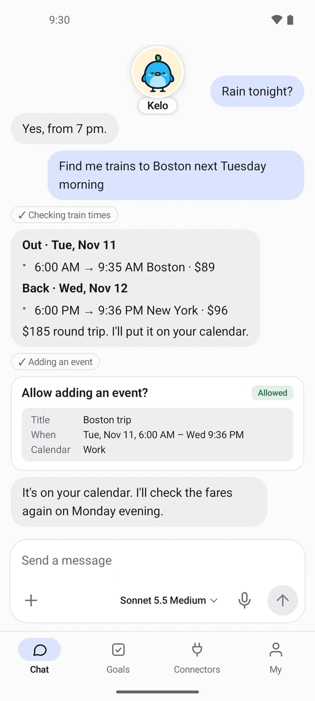
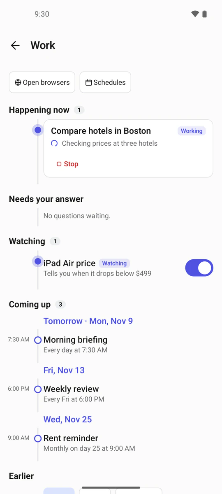
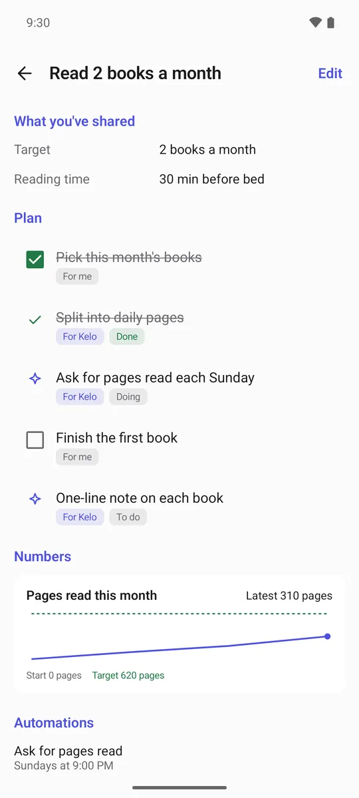
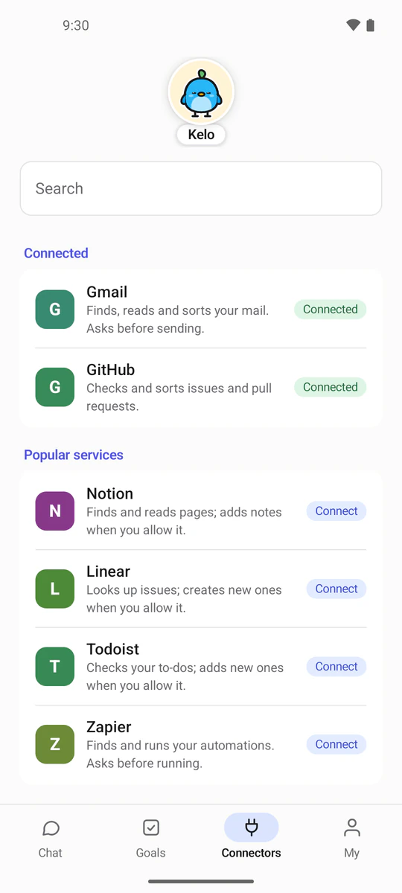

<p align="center"></p>

<p align="center">
  <b>A personal AI assistant that runs on a server you choose, with the AI model you choose — local models included.</b><br>
  You talk to it from your phone. It does the work in its own browser and the services you connect, and it asks before anything hard to undo.
</p>

<p align="center">
  <a href="https://kelo.chat"></a>
  <a href="https://kelo.chat/#install"></a>
  <a href="https://www.gnu.org/licenses/agpl-3.0.html"></a>
  <a href="https://kelo.chat/#get-app"></a>
  <a href="README.ko.md"></a>
</p>

<p align="center">
  <a href="https://kelo.chat">kelo.chat</a> ·
  <a href="docs/install.md">Install</a> ·
  <a href="CHANGELOG.md">Changelog</a> ·
  <a href="README.ko.md">한국어</a>
</p>

---

## Why Kelo

**Your server, where you want it.** The Kelo server runs on a Mac at home, a Linux box, a mini PC or NAS with Docker, or a cloud
server. Chats, memory, files and keys stay on that server. The phone app is the remote.

**Any model you want — even a local one.** Pick from about 30 AI providers (Claude, GPT, Gemini, DeepSeek, Qwen, Mistral, Grok,
OpenRouter and more), or run a model on your own hardware with LM Studio, Ollama or any OpenAI-compatible server. With a local
model, your conversation never leaves your hardware. A fallback model from a different provider takes over when the main one fails.

**It asks first.** Looking things up just happens. Anything that commits something for you — paying, ordering, booking, sending,
deleting, changing an account — waits for your OK on the phone. When a site wants to check that you're a person, Kelo hands the
browser to you instead of trying to get around it.

<p align="center">
  
  
</p>

## What it does

- **Chat from your phone** — text or voice, photos and documents (PDF, Word, Excel), or share from any app with "Send to Kelo".
- **Its own browser** — opens sites, reads and compares, fills forms and signs in with logins you saved. Watch it live, take over,
  and hand it back.
- **Quick look-ups without a browser** — web search and page reading for prices, comparisons and facts, right in the chat.
- **Background work** — long jobs keep going with every step shown; questions they need come to the chat as cards.
- **Schedules and watchers** — run things at set times; get told when a page shows certain words or a number crosses your limit.
- **Goals** — write down a goal; Kelo keeps the plan, steps, numbers and due dates with you.
- **Skills it learns, with your OK** — after a task Kelo can propose its steps as a skill, or you tap "Save as skill"; nothing is
  used until you approve the text in My → Records. Skill folders format: [docs/packages.md](docs/packages.md).
- **Connectors** — Gmail and other mailboxes, calendars, GitHub, Notion, Linear, Todoist and many more, each connected on the
  service's own sign-in page.
- **Your other self-hosted apps** — Home Assistant, Frigate, Immich, Paperless-ngx, Mealie, Tandoor, Grocy, Actual Budget, Firefly III,
  Linkwarden, Karakeep, Wallabag, Miniflux, FreshRSS, n8n, Uptime Kuma, Beszel, AdGuard Home, Pi-hole, Nextcloud, Gitea and Forgejo, by
  their address on your network; see [Works with your other self-hosted apps](#works-with-your-other-self-hosted-apps).
- **Keychain and cards** — passwords and keys go in through a form, never the chat, and the agent never sees them. Cards can be
  locked with a key only your phone holds.
- **Notifications** — when a task finishes or needs your OK. Pushes carry no content; the app fetches it from your own server.
- **20 languages** in the apps; Kelo answers in the language you write in.

<p align="center"></p>

## Works with your other self-hosted apps

In the app, Connectors → Self-hosted: type the address of an app the way you open it on your network (`http://192.168.0.10:8123`, a name
on your network, a Tailscale address, or `host.docker.internal` for an app on the server computer itself), paste the key or sign-in the
app asks for, and Kelo tries it with one real request before saving. Kelo then talks to the app directly: nothing goes through us and
nothing leaves your network.

Home Assistant (REST, and its MCP Server when you add that integration), Frigate, Immich, Paperless-ngx, Mealie, Tandoor, Grocy, Actual
Budget (through the community [actual-http-api](https://github.com/jhonderson/actual-http-api)), Firefly III, Linkwarden, Karakeep,
Wallabag, Miniflux, FreshRSS, n8n (its API, and an MCP Server Trigger for running workflows), Uptime Kuma (its Prometheus status page),
Beszel, AdGuard Home, Pi-hole (v6), Nextcloud, Gitea and Forgejo.

- **Only you can set an address.** It is typed in your app's connection form and stored sealed with the key. The assistant has no tool to
  make or change one, so text on a page or in a mail cannot point Kelo at your network.
- **Always refused**, even for your own address: loopback (`127.0.0.1`, `::1`) and link-local (`169.254.x.x`, `fe80::`). Loopback inside
  the container is Kelo's own server (and the browser's DevTools next to it), so a connection pointed there could let outside text steer
  Kelo into its own admin API. `169.254.169.254` is the cloud metadata service, which on a cloud VM hands out the machine's credentials.
  Private, Tailscale and public addresses are allowed; redirects are never followed; a name is resolved once and that address is used.
- **Devices.** When you ask for something in your own message ("unlock the front door", "turn the boiler off"), Kelo does it at once on
  your Home Assistant, with no approval card. It asks first for anything it would do on its own, in a background job, or after text from
  a page, mail or message reached the run. A task you set up with its own permission runs as you allowed it.
- **Pictures and files** (a Frigate snapshot, an Immich photo, a Paperless PDF) are saved to your library and pictures can be shown in the chat.
- **Coming later:** https addresses with a self-signed certificate (for example Frigate's signed-in port 8971); use the plain http port or an
  address with a valid certificate for now.

## Apps

<p>
  <a href="https://apps.microsoft.com/detail/9P54HX2TX361?hl=en-us&gl=US"></a>
  <a href="https://apps.apple.com/us/app/kelo-ai/id6832422201"></a>
  <a href="https://kelo.chat/tester"></a>
</p>

| Platform | Status |
|---|---|
| Android | Native app (Kotlin + Jetpack Compose). In beta testing: sign up at [kelo.chat/tester](https://kelo.chat/tester), or sideload the APK: [kelo.chat/download/android](https://kelo.chat/download/android). Google Play comes after the beta. |
| Windows / macOS desktop | Native app (Compose Multiplatform): chat, approvals, live browser, tray, notifications. Windows: [Microsoft Store](https://apps.microsoft.com/detail/9P54HX2TX361?hl=en-us&gl=US), or the direct files: [installer (.exe)](https://kelo.chat/download/windows) or [MSI](https://kelo.chat/download/windows-msi); macOS (Apple silicon): [disk image (.dmg)](https://kelo.chat/download/mac). |
| iOS | Native app (SwiftUI), on the [App Store](https://apps.apple.com/us/app/kelo-ai/id6832422201) (iOS 17 or later). |

Versions, sizes and SHA-256 of the current builds: [kelo.chat/download/latest.json](https://kelo.chat/download/latest.json).

- **Android:** open the APK; if Android asks, allow installing apps from this source (your browser or file manager). Android 8.0 or later.
- **Windows:** the Microsoft Store version has no such warning. The direct installer files aren't code-signed yet. If a blue "Windows protected your PC" window (SmartScreen) appears, click **More info**, then **Run anyway**. On a PC with **Smart App Control** turned on (Windows 11, Settings → Privacy & security → Windows Security → App & browser control), Windows blocks the unsigned setup .exe, and there is no "Run anyway" for it. Install the Microsoft Store version there; direct installers are not supported with Smart App Control on yet. Windows 10 or 11.
- **macOS:** drag Kelo to Applications. It is signed and notarized by Apple, so it opens right away. Apple silicon (M1 or later).

<p align="center">
  
  
  
  
</p>

### Verify the downloads

You don't have to trust the files, only the public source. Each release is built in public by GitHub Actions
([`release-build.yml`](.github/workflows/release-build.yml)) and every file carries a signed record of which source made it:

```sh
gh attestation verify Kelo-<version>.msi -R kelo-chat/kelo     # also .exe, .msix and the Android files
```

- **Android (APK from kelo.chat):** the app is built in a pinned Docker environment, so building the tagged source gives the same file.
  `tools/verify/android-verify.sh --tag <tag>` builds it and compares it with the APK on your phone (the signature is the one thing left out).
  The **Google Play** version can't be compared byte for byte: Google Play adds its own protection code to the apps it delivers. To check,
  install the APK from kelo.chat.
- **Windows:** the installers are not byte-for-byte reproducible; the attestation shows the workflow and commit that built them.
- **iPhone:** Apple encrypts every App Store app per device, so a byte-for-byte check is impossible. The doc says what you can check.

Steps, limits and what is not covered: [docs/verify-builds.md](docs/verify-builds.md).

## Install the server

**Needs:** on macOS and Linux, Docker (Docker Desktop on macOS, Docker Engine on Linux). On Windows, the one-line installer needs nothing else (Docker Desktop is only for the Docker route).

| | RAM | CPU | Free disk |
|---|---|---|---|
| Minimum | 2 GB | 2 cores | 10 GB |
| Recommended | 4 GB | 4 cores | 20 GB |

The setup asks for one of these sizes (or No limit). Kelo then stays within it: all of its containers together, program files
included. Change it later with `kelo limits --choose`.

The one-line installer opens when Kelo is published:

```bash
# macOS and Linux
curl -fsSL https://kelo.chat/install.sh | bash
```

```powershell
# Windows (PowerShell): one line, no questions in the terminal; no Docker needed.
# It asks for administrator permission once, installs Kelo Server (its own WSL 2 system) and opens the setup page.
irm https://kelo.chat/install-windows.ps1 | iex
```

Windows with Docker Desktop instead (needs Docker Desktop with WSL 2):

```powershell
irm https://kelo.chat/install.ps1 | iex
```

Until then, from a copy of this repository:

```bash
KELO_SOURCE=/path/to/this/repo bash scripts/install.sh
```

The installer checks Docker, copies Kelo, and opens a four-step guided setup: check the server, pick a size, start Kelo, connect
your phone with a QR code. The AI model is chosen in the app afterwards. Full guide: [docs/install.md](docs/install.md).

### Reaching your server from the phone

- **Kelo address** — a `<name>.kelo.chat` address, offered for now (`kelo connect kelo --name <name>`). Availability and terms may change.
- **Tailscale** — private, no public address.
- **Your own domain** — DuckDNS or any domain you own.

See [docs/connect.md](docs/connect.md).

### Through Nginx Proxy Manager

Many self-hosters already run Nginx Proxy Manager (NPM). With your own domain this takes about five minutes (replace `kelo.example.com`):

1. In your DNS, point `kelo.example.com` at the address your NPM answers on.
2. On the Kelo computer run `assistant connect domain --host kelo.example.com --proxy`. Kelo listens on your home network and prints the address to forward to, like `http://192.168.1.20:8080`.
3. In NPM: **Hosts → Proxy Hosts → Add Proxy Host**. Details tab: Domain Names `kelo.example.com`, Scheme `http`, Forward Hostname / IP the printed address (without `http://`), Forward Port the printed port (8080 unless you changed it). Turn on **Websockets Support** and **Block Common Exploits**.
4. SSL tab: *Request a new SSL Certificate*, **Force SSL**, **HTTP/2 Support**, accept the Let's Encrypt terms.
5. Advanced tab, so replies stream as they are written and photos can be uploaded:

   ```
   proxy_buffering off; proxy_request_buffering off; proxy_cache off;
   proxy_read_timeout 300s; proxy_send_timeout 300s; client_max_body_size 30m;
   ```

   Save.
6. Check with `assistant connect status`, then `assistant phone add` and scan the QR code with the Kelo app: it now uses `https://kelo.example.com`.

Kelo answers plain http on your home network, so let only NPM reach that port if your firewall allows it. Undo with `assistant connect off` and delete the host in NPM.

### Tip: run Kelo for free

You can run Kelo without paying for a server or a model: Oracle Cloud's Always Free tier includes an Arm server that stays free,
and [FreeLLMAPI](https://github.com/tashfeenahmed/freellmapi) pools the free tiers of many model providers behind one
OpenAI-compatible address. Kelo's images build for Arm (linux/arm64) as well as x86, Chromium included.

1. **Make the server.** Sign up for [Oracle Cloud Free Tier](https://www.oracle.com/cloud/free/) and create a VM in your
   **home region** (Always Free works only there): shape **VM.Standard.A1.Flex** (Ampere, Arm) with **2 OCPUs and 12 GB of
   memory**, image **Ubuntu** (aarch64). That is the whole Always Free A1 allowance; the default boot volume is enough (200 GB of
   block storage is free in total). "Out of host capacity" means no free Arm machine is available right now: try another
   availability domain, or try again later.
2. **Install Kelo.** SSH in and run the installer above. It offers to install Docker, then opens the guided setup; **No limit**
   is a good size here, since the VM is only for Kelo. Choose a `https://<name>.kelo.chat` address (offered for now): it works through an
   outgoing tunnel, so you don't open any ports in Oracle's firewall.
3. **Add FreeLLMAPI on the same VM**, joined to Kelo's Docker network so Kelo reaches it by name while it stays closed to the
   internet:

   ```bash
   curl -fsSL https://freellmapi.co/install.sh | bash
   cd ~/freellmapi
   cat > docker-compose.override.yml <<'EOF'
   services:
     freellmapi:
       networks: [default, kelo]
   networks:
     kelo:
       name: kelo_agent   # Kelo's network when Kelo lives in ~/kelo (`docker network ls` shows it)
       external: true
   EOF
   docker compose up -d
   ```

   Open its dashboard from your laptop through SSH (`ssh -L 3001:127.0.0.1:3001 ubuntu@<server address>`, then
   `http://localhost:3001`), add the free API keys you signed up for, and copy the unified key.
4. **Point Kelo at it.** In the app, My → Model → **Custom endpoint**: server address `http://freellmapi:3001/v1`, API key = the
   unified key, model `auto` (FreeLLMAPI picks a free model and moves to the next one when a provider hits its limit).

Keep in mind:

- **Free models are weaker at tools.** Free-tier models are usually slower and less reliable at tool use (browsing, filling in
  forms, multi-step tasks) than paid ones, and their daily limits can run out. A paid model as main or fallback is safer for
  important work.
- **Their terms apply.** FreeLLMAPI is a separate MIT-licensed project meant for one person's own use. Oracle's terms and each
  model provider's free-tier terms (limits, data use, allowed use) still apply.


### Useful commands

```bash
kelo status            # each copy: running or not, its address
kelo phone add         # sign another phone in (QR code)
kelo limits --choose   # Recommended, Minimum or No limit
kelo instance create alex   # another person on the same server, with their own data and keys (then its address and a QR code)
kelo instance list           # every copy, its address and whether it runs
kelo instance stop alex      # stop a copy; its data stays (`kelo instance start alex` brings it back)
kelo instance delete alex    # delete a copy completely: its chats, keys, files, settings and address
```

### Updating

`kelo update` (or `kelo update alex`, or `kelo instance update` for every extra copy) updates safely: it checks free disk,
remembers the images the copy runs, backs up its data inside its own volume (a consistent copy of the database plus its files; the
newest 3 are kept), rebuilds, restarts and checks that the copy answers, opens its database and serves a request. If any step fails
it rolls back by itself to the previous images, puts the backup back if the new version had changed the database, and says so.
`kelo rollback [name]` goes back to the version before the last update on purpose (the only way to downgrade); `kelo backups [name]`
lists the backups.
The database is upgraded in place when a new version starts, and there are no down-migrations, so the data and the version move
together: if the database layout changed since the rollback point, going back also restores the backup taken at that point
(changes made after it are lost; `kelo rollback` backs up the current data first). If the layout did not change, the current data is
kept. `--keep-data` skips the restore at your own risk.

#### From the app, with one button

The owner's phone (or computer) can update the server too: **My → Server update** shows "Server update available: 0.5.0" with
what is new, an **Update** button, the progress, and the result. It runs the same steps as `kelo update` (free disk, rollback point,
backup, new images, restart, health check, automatic rollback on failure), and the page says which version the server went back to
if the new one failed. **Update automatically at night** (off by default) does it by itself in the quietest time Kelo learned from
your own use, outside your contact hours, when no chat is running, at most once a night, and tells you the result with a
notification. Other people's phones see nothing.

How it works: a small extra container, the **updater**, is the only part of Kelo that may use Docker. It has no AI and reads no
web pages or mail, publishes no port, and answers only the main copy's server, on an internal network, with a secret made at setup
(`UPDATER_TOKEN`, never shown). It knows four fixed commands: status, check, update to the latest release, and roll back. It only
installs the release named in the official list (`https://kelo.chat/download/latest.json`), pulls each image by its digest from
`ghcr.io/kelo-chat` (or `KELO_REGISTRY`), and refuses it unless the digest, the signature of Kelo's release workflow (cosign,
keyless) and the version all check out. It updates the main copy first, then every extra copy (they share the images), and itself
last. The Claude and agy containers are never published (their CLIs are proprietary): they stay built on your server, and each CLI
updates itself from the app (My → Model).

```bash
kelo updater setup [--auto-update]   # turn it on (the installer does this and asks about nightly updates)
kelo updater status                  # what the server runs, the newest release, the last update
kelo updater off                     # remove the container; `kelo update` keeps working
kelo update --from-release           # the same update from the terminal (the default once the server runs release images)
kelo update --from-source            # build from these files instead (development)
```

A server built from the source files (the way it is installed today, or with Google Chrome) shows "built from the source files:
update it on the server machine with `kelo update`" in the app and has no button. A release that needs newer setup files
(`compose.yml`) says to run the installer again (your data stays).

### Sign in with a subscription account (optional)

`kelo enable oauth` lets you sign in with a subscription account (Claude, Antigravity and others) instead of an API key.
It also installs Claude Code and Antigravity, each in its own container; you sign in from the app under My → Model.
These companies have not confirmed that their subscriptions may be used from other apps, so the app asks once before each
one is used. Turn it off with `kelo disable oauth`.

### An Android device Kelo can use (optional)

For apps with no usable website (delivery, booking, app-only coupons), Kelo can drive an Android device: it reads the screen, taps,
types (Korean too) and opens apps, with the same approval rules as its browser (payments, sending and deleting ask), and it signs in
with the login you enter in its secure card. The device can be:

- **next to Kelo**: [redroid](https://github.com/remote-android/redroid-doc) (Android in a container) on a Linux machine on your network,
  an emulator, or a VM;
- **a spare phone** with wireless debugging turned on;
- **on the same Linux server as Kelo** (Docker Desktop on macOS and Windows cannot run redroid).

Turn it on in `.env`, then build the bridge (a small container that talks adb to the device) and update:

```bash
COMPOSE_PROFILES=...,android               # add android to the profiles you have
ANDROID_DEVICE=192.168.0.20:5555           # the device's adb address
ANDROID_BRIDGE_TOKEN=<32+ random characters>
```

```bash
docker compose --profile android build android
kelo update
```

What each place needs:

| | Next to Kelo (redroid on Linux) | Same server as Kelo (redroid) | Spare phone |
| --- | --- | --- | --- |
| Machine | x86_64 or arm64 Linux with Docker; 2.5 GB of free memory, 4 GB of disk | the Kelo server itself, Linux only, 2.5 GB more memory | any Android 11+ phone, always on and charging |
| Kernel | `binder_linux` (most distributions; Ubuntu: `linux-modules-extra`), plus `loop` and `erofs` for Android 15 | same | none |
| Setup | the commands below, then `ANDROID_DEVICE=<its LAN address>:5555` | the commands below, but with `--network <kelo-project>_android-out` instead of `-p` (find it with `docker network ls`; no port is opened), then `ANDROID_DEVICE=redroid:5555` | Developer options → Wireless debugging → Pair with code, then `adb pair` / `adb connect` once from a computer; `ANDROID_DEVICE=<phone address>:<port>` |
| Network | the Kelo server must reach the device's port (a Mac running Docker Desktop or colima may need its Local Network permission, or a small relay) | none | the phone on the same network as the server |

redroid on Linux (Android 15):

```bash
echo "options binder_linux devices=binder,hwbinder,vndbinder" | sudo tee /etc/modprobe.d/redroid.conf
printf "binder_linux\nloop\nerofs\n" | sudo tee /etc/modules-load.d/redroid.conf
sudo modprobe binder_linux devices=binder,hwbinder,vndbinder && sudo modprobe loop && sudo modprobe erofs
printf 'KERNEL=="binder", MODE="0666"\nKERNEL=="hwbinder", MODE="0666"\nKERNEL=="vndbinder", MODE="0666"\n' | sudo tee /etc/udev/rules.d/60-redroid-binder.rules
sudo chmod 666 /dev/binder /dev/hwbinder /dev/vndbinder
docker run -d --privileged --name redroid --restart unless-stopped --memory 2560m -v redroid-data:/data \
  -p <lan-address>:5555:5555 redroid/redroid:15.0.0-latest \
  androidboot.redroid_gpu_mode=guest androidboot.redroid_width=720 androidboot.redroid_height=1280 androidboot.redroid_dpi=320
```

**Google Play.** redroid's own images have no Google apps. On x86_64, build one with LiteGapps (MindTheGapps' x86_64 builds carry a
2022 Play Store that crashes on Android 14 and 15). The recipe in [regulad/redroid-script](https://github.com/regulad/redroid-script)
pins every download by its checksum; build it yourself rather than pulling a ready image:

```bash
git clone https://github.com/regulad/redroid-script && cd redroid-script
docker build -t redroid:15-gapps \
  --build-arg BASE=docker.io/redroid/redroid:15.0.0-250627 \
  --build-arg TOOLS=docker.io/library/alpine:3.24.3 --build-arg BUSYBOX=docker.io/library/busybox:1.38.0-musl \
  --build-arg GAPPS_KIND=litegapps --build-arg LITEGAPPS_TREE=x86_64/35 \
  --build-arg GAPPS_URL=<litegapps-15.0-x86_64 url from matrix.json> --build-arg GAPPS_SHA256=<its sha256 from matrix.json> \
  --build-arg ADDON_URL=<litegapps-setupwizard-15.0-x86_64 url> --build-arg ADDON_SHA256=<its sha256> \
  --build-arg NATIVE_BRIDGE=none .
```

Then run `redroid:15-gapps` in the `docker run` above instead of `redroid/redroid:15.0.0-latest` (a new data volume), and sign in to
Play by asking Kelo ("sign in to the Play Store"): the login card types it on the device. `NATIVE_BRIDGE=none` leaves out ARM
translation, so apps built only for ARM do not install. If you need ARM-only apps, use a spare phone or redroid on an ARM server (Raspberry Pi, Ampere) rather than an ARM
translation layer: those layers are closed files without the right to redistribute them, and unstable on Android 15.

**Typing.** Install [ADB Keyboard](https://github.com/senzhk/ADBKeyBoard) on the device (`adb install` its APK, then
`adb shell ime enable com.android.adbkeyboard/.AdbIME`) so Kelo can type more than plain ASCII (Korean, emoji).

Bank and payment apps usually refuse emulators, and an app that allows one phone per account may sign your phone out. Details:
[docs/android-device.md](docs/android-device.md).

## How it's built

- **Server** — Python (FastAPI) in Docker, with a sandboxed Chromium browser, an egress proxy that refuses private addresses, and a
  separate work room for running code. One SQLite database per copy; secrets are encrypted at rest.
- **Apps** — native on every platform: Kotlin + Compose (Android, desktop), SwiftUI (iOS). No web views.
- **Models** — Anthropic, OpenAI, Google, OpenRouter, Bedrock, Vertex, Azure, DeepSeek, Mistral, xAI, Groq, Together, LM Studio,
  any OpenAI-compatible server, and more.

More: [docs/browser.md](docs/browser.md) (the browser and its safety rules), [docs/vpn.md](docs/vpn.md) (browsing through your VPN or proxy), [docs/push.md](docs/push.md) (notifications),
[docs/google.md](docs/google.md) (Google sign-in).

## Privacy

**Your data stays on your server.** Your chats, notes, saved keys and cards are stored only on the Kelo server you run.
The developer has no way into it and does not collect your conversations.

AI provider keys you enter in the app are kept by a separate small program on your server, not by Kelo itself. Kelo asks it to
make the model call; it adds the key only for that provider's own address. Under Keyguard, it stays locked until your phone unlocks
Kelo.

kelo.chat helps with only a few things:
- **Kelo address (offered for now):** the Kelo project offers `name.kelo.chat` addresses for now; availability and terms may change. Traffic uses https through a Cloudflare Tunnel to your server; use Tailscale or your own domain if you'd rather avoid this.
- **Notifications:** push notifications carry only an ID that something new happened. The app fetches the content from your server.
- **Google and GitHub sign-in:** it brokers the sign-in and the token exchange. Tokens pass through but are never stored.

Your messages are sent to the AI provider you choose (for example Anthropic or Google), under that provider's terms.
The source is public, so anyone can verify all of this. Policy: [kelo.chat/privacy](https://kelo.chat/privacy).

## Project status

Kelo is a solo project, built and maintained by one person, so some parts may still be rough.
I'll do my best to fix reported issues, but since I work on Kelo alongside a full-time job, I can't promise how quickly that will happen.
Issues and suggestions are always welcome.

### In development

- **Several custom endpoints**: save more than one OpenAI-compatible endpoint, each under a name you choose, and pick between
  them in the model list.
- **Messenger channels**: talk to Kelo from Telegram, Discord and Slack, set up from the Connectors list, with replies as they
  happen (no polling).
- **Native server install on Windows and macOS**: run the Kelo server without Docker, as an extra option next to it.
- **Kelo Nest**: a place to find and add skills, connectors and app extensions (new tabs) made for Kelo.

## License

Kelo is free software under the [GNU Affero General Public License v3.0 or later](LICENSE), for everyone. If you run a
modified Kelo server for other people over a network, the AGPL asks you to offer them the source of your version.

**Commercial licence.** If the AGPL does not fit how you want to use Kelo (for example, shipping it inside a closed
product or service without sharing your changes), a commercial licence is available on request: support@kelo.chat.

**Contributing.** Outside pull requests are not accepted yet. Bug reports and ideas are welcome as issues. See
[CONTRIBUTING.md](.github/CONTRIBUTING.md).

The Kelo name, logo and mascot are not covered by the licence; forks need their own. Third-party code, fonts and service
icons, and their licences: [NOTICE](NOTICE).

Questions: support@kelo.chat
